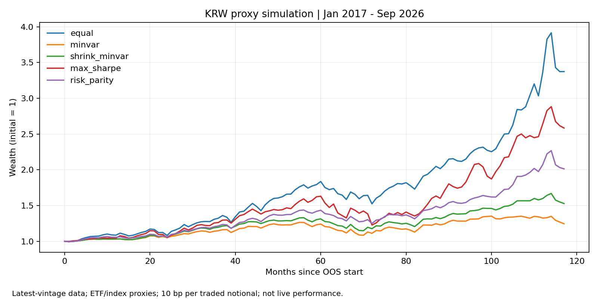

# Phase 2-3 실제 관측 데이터 기반 SAA 예비 비교

> **2026-10-29 재검증: 국내 ETF 월말/배당 원자료 결함 발견. 한국 자산 포함 아래 성과표는 보존용 기존 결과이며 정책 판단에 사용하지 않는다. [검증 보고서](../20261029-validation/README.md)를 우선한다.**

작성: 2026-10-29 KST. 기준 월말: 2026-09-30. **RESEARCH_ONLY / PROVISIONAL**.
실제 다운로드한 관측값과 ETF 프록시를 사용한 가상 운용 비교이며 실제 계좌 운용성과가 아니다. IPS v0.4는 DRAFT이다.

## 수집 범위와 품질

| 요청 자산 | 이번 자료 | 연속 월 수익률 사용 가능 기간 | 성격·한계 |
|---|---|---|---|
| 한국 주식 | KODEX 200 (069500.KS), Yahoo 배당조정 종가 | 2009-05~2026-09 (209개월) | KOSPI200 ETF 프록시. 한국 전체 주식시장/TR 지수 자체가 아님. 2007~2009초 결측을 메우지 않음 |
| 미국 주식·S&P500 | SPY, Yahoo 배당조정 종가 | 2004-02~2026-09 (272개월) | 미국 대형주 ETF, 전체 미국 시장을 대표하는 전시장 지수는 아님. 비용·추적오차 포함 |
| NASDAQ100 | Nasdaq 제공 FRED NASDAQXNDX | 1999-04~2026-09 (330개월) | 공식 총수익지수. ETF 보수 없음. 지수 사후 산출/과거 소급 이력과 당시 편입 가능성은 추가 확인 필요 |
| 한국 국채 | KIWOOM 국고채10년 (148070.KS), Yahoo 배당조정 종가 | 2011-11~2026-09 (179개월) | 약 14년 11개월. 국채 전체가 아닌 10년 구간, 3년 국채와 위험이 다름 |
| 미국 국채 | IEF, Yahoo 배당조정 종가 | 2004-02~2026-09 (272개월) | 7~10년 국채 ETF. 단기국채/국채 전체와 구별 |
| USD/KRW | Fed H.10 / FRED DEXKOUS | 원시 관측 1981-04부터 | 1 USD당 KRW, 뉴욕 정오 매입환율. 한국/미국 주식 종가와 시각 불일치 |
| 미국 단기금리 | Fed H.15 / FRED DGS3MO | 원시 관측 1981-09부터 | 3개월 만기 국채 연율 수익률. 채권 총수익률이 아님 |
| 한국 단기금리 | OECD / FRED IR3TIB01KRM156N | 원시 관측 1991-01부터 | 월별 3개월 은행간 금리. 국채 무위험금리나 실제 예금/현금 운용성과가 아님 |

개별 원본의 실제 끝 날짜·유효/결측 개수는 `results-summary.json`의 `qa.coverage`, 다운로드 주소·시각·SHA256은 `source-manifest.json`에 있다. 수집은 2026-10-29 KST이며 manifest는 UTC로 기록한다. FRED의 10월 원시값은 보존하지만 분석에는 9월까지만 사용한다.

공식 출처를 먼저 확인했다. KRX 공개 API는 키 발급 및 서비스 활용 승인이 필요하며, 이번 세션에서는 승인된 KRX 키로 공식 장기 TR 시계열을 확보하지 못했다. FRED SP500은 가격지수이므로 배당 포함 분석에서 배제했다. 공식 지수 확보가 끝났다고 주장하지 않는다.

### 실제로 수행한 품질 점검

- 원본 해시 확인, 날짜 중복·정렬·유한값·양수 가격 검사, 원본 null 집계.
- 일별 자료를 요청해도 Yahoo `range=max`가 월별 자료를 반환하는 경우가 확인됨. 최종 수집은 시작/끝 epoch를 명시하고 응답 `dataGranularity=1d`를 검사한다.
- 거래소 현지 시간대 기준 날짜로 변환. 월 마지막 유효 관측을 사용하되 월말에서 7일 넘게 떨어진 값은 해당 월에서 제외. 월 사이의 가격 보간·과거 연장 없음.
- 전월과 해당 월 모두 존재할 때만 수익률을 계산하고, 실험 공통 구간에 빠진 월이 있으면 중단한다. 일별 null이 모두 휴일인지 완전히 판별한 것은 아니다.
- 국고채10년 ETF의 2018/2019/2020/2022/2023/2024/2025 분배 연도·금액을 운용사 공개 내역과 대조. 지급기준일·분배락일은 서로 다른 날짜이다. 전 역사 전수 검증은 아님.
- KODEX 200의 2025년 7월 분배금 176원을 공식 공지와 대조.
- IEF의 2024년 조정종가 수익률 약 -0.6342%를 운용사 시장가격 수익률 -0.63%와 대조(허용 오차 0.05%p).
- **114260.KS 국고채3년은 제외:** 공식 2025년 12월 분배금 807원이 존재하지만 다운로드 이벤트는 2018년에서 끝남. 임의 보정 없이 제외. 제외 원본과 해시는 개인 스냅샷에 보존.

이 검사는 `PARTIAL_CROSS_CHECK`이다. 데이터에 `quality=verified`를 붙이지 않고 `research_proxy`로 기록했다. 전체 기업행동·분배 재투자·독립 공급자 전수 대조·라이선스 재배포 승인은 아직 완료되지 않았다.

## 실험 설계

- 기본 자산: 한국 주식, S&P500, NASDAQ100, 한국 10년 국채, 미국 7~10년 국채. **S&P500과 NASDAQ100은 종목이 겹친다.** 동일가중은 경제적으로 독립된 5개 위험군의 동일 배분이 아니며 미국 주식에 40%를 배분한 기준선이다.
- 60개월 과거 수익률 학습, 2개월 신호 공백, 매 12개월 리밸런싱. 그 사이 비중은 수익률에 따라 변한다. 신규 자산 상장 전 수익률 없음.
- 2개월 공백은 당월·직전월 확정값을 신호에 쓰지 않는 연구 가정이다. 원시 `available_at`은 미확인으로 비워 두며 **당시 실제 가용시점을 인증한 백테스트가 아니다**. 최신 빈티지·현재 생존 ETF 선택에 따른 편향이 남는다.
- 롱온리·합계 100%, seed 17, 무작위 후보 2,500개에 동일가중/단일자산/쌍별 후보를 추가. 수학적 최적해 보장 없음. 정책상 집중도 한도로 해석하지 않는다.
- 원화 수익률: `(1 + 현지통화 총수익률) × (1 + USD/KRW 변화율) - 1`. 원화 ETF는 FX 변환 없음. 세금·환전 스프레드·현금흐름·계좌 규정·레버리지·인출 없음.
- 거래비용은 매수·매도 거래액 비중 절댓값 합에 **편도 10bp** 적용. 최초 진입 비용 제외. 기존 JSON의 `round_trip_cost_bps_per_unit_turnover`는 레거시 이름이며, 왕복 전체에 10bp라는 뜻이 아님. 0/10/30bp도 비교한다.
- ETF 수익률에는 보수 등이 이미 반영되지만 지수 수익률에는 ETF 보수가 없다. 이를 동일 상품의 실현 가능 수익으로 간주하지 않는다.
- 금리의 월 현금수익은 **관측 연율 금리 / 1200으로 추정**. 3개월 전 관측월 값을 사용한다. 실제 투자 가능 무위험 수익이 아니며 임의 생성한 가격도 아니다. 원화 Sharpe/Sortino에는 한국 금리 프록시를 사용; 미국 금리는 수집·가공했지만 이 KRW 비교에는 사용하지 않는다.
- CAGR은 월별 순수익 복리의 연율, MDD는 월말 NAV 고점 대비 최저 하락률이다. **일중/일별 MDD보다 작게 보일 수 있다.** Sharpe는 월 초과수익 평균/표본표준편차 × √12. Sortino는 같은 평균/모든 월을 분모로 한 음의 초과수익 RMS × √12. RF=0/MAR=0 기존 지표도 JSON에 별도 보존.
- 마지막 2024-01~2026-09 구간은 사후 구간 진단이며, 연구자가 보지 않은 순수 홀드아웃이라고 주장하지 않는다.

## 계산 결과

아래 표는 스크립트 산출값으로 생성한다. 실험별 자산·기간이 다르므로 서로 다른 표의 성과를 동일 조건의 승패로 비교하면 안 된다.

### five_asset

입력 2011-11~2026-09 (179개월), OOS **2017-01~2026-09**.

| 전략 | CAGR | 월말 MDD | Sharpe (금리 프록시) | Sortino (금리 프록시) |
|---|---:|---:|---:|---:|
| 동일가중 | 13.28% | -16.99% | 0.947 | 1.596 |
| 최소분산 | 2.27% | -14.28% | 0.049 | 0.069 |
| Shrinkage 최소분산 | 4.44% | -13.72% | 0.403 | 0.606 |
| Sharpe 극대화 | 10.23% | -24.73% | 0.712 | 1.120 |
| 위험기여 균형 | 7.44% | -13.09% | 0.698 | 1.112 |

### without_kr_bonds

입력 2009-05~2026-09 (209개월), OOS **2014-07~2026-09**.

| 전략 | CAGR | 월말 MDD | Sharpe (금리 프록시) | Sortino (금리 프록시) |
|---|---:|---:|---:|---:|
| 동일가중 | 15.52% | -18.85% | 1.009 | 1.817 |
| 최소분산 | 8.45% | -16.44% | 0.689 | 1.185 |
| Shrinkage 최소분산 | 9.97% | -15.28% | 0.860 | 1.448 |
| Sharpe 극대화 | 15.91% | -25.51% | 0.994 | 1.666 |
| 위험기여 균형 | 11.89% | -15.21% | 0.916 | 1.629 |

### us_only_long

입력 2004-02~2026-09 (272개월), OOS **2009-04~2026-09**.

| 전략 | CAGR | 월말 MDD | Sharpe (금리 프록시) | Sortino (금리 프록시) |
|---|---:|---:|---:|---:|
| 동일가중 | 13.30% | -17.34% | 1.039 | 1.782 |
| 최소분산 | 8.52% | -15.10% | 0.741 | 1.198 |
| Shrinkage 최소분산 | 9.89% | -14.66% | 0.858 | 1.430 |
| Sharpe 극대화 | 13.71% | -22.66% | 0.854 | 1.437 |
| 위험기여 균형 | 11.30% | -14.50% | 0.956 | 1.616 |



## 민감도 및 해석

같은 5자산·2022-01~2026-09 OOS·동일 리밸런싱 일정의 학습기간별 Sharpe:

| 전략 | 36개월 | 60개월 | 120개월 |
|---|---:|---:|---:|
| 동일가중 | 0.753 | 0.753 | 0.753 |
| 최소분산 | -0.365 | -0.380 | 0.021 |
| Shrinkage 최소분산 | 0.037 | 0.068 | 0.176 |
| Sharpe 극대화 | 0.917 | 0.523 | 1.027 |
| 위험기여 균형 | 0.587 | 0.485 | 0.496 |

기본 5자산 결과에서 동일가중의 Sharpe/Sortino가 가장 높았다. 최소분산은 변동성 축소를 목표로 하므로 수익·Sharpe 최대화와 같지 않다. 한국 장기국채 편중과 금리 상승 국면의 영향은 후속 원인 분석 대상이다. 학습기간 민감도에서는 Sharpe 극대화 결과가 크게 변하며 일부 설정에서는 동일가중을 앞선다. 따라서 **최적화가 항상 우월하다거나 동일가중이 최종 정책이라고 결론 내릴 수 없다**.

비용 30bp로 높여도 이번 기본 5자산 Sharpe 순서는 유지되었다. 다만 연 1회 재배분·초기 진입 비용 제외 조건이므로 실제 잦은 거래 비용 영향으로 일반화할 수 없다. 마지막 구간과 비용별 수치는 JSON에 모두 기록했다. 관측 결과를 보고 선택한 최선의 파라미터를 정책으로 채택하지 않는다.

## 재현 방법

원본 전체와 월별 패널은 개인 보관 스냅샷 ZIP에 있다. 공개 GitHub에는 원시 금융 시계열을 재배포하지 않고 코드·요약·출처 해시만 기록한다. 원본을 `data/snapshot-20261029`에 복원한 후:

```bash
python3 tools/saa_market_data.py --root data/snapshot-20261029
python3 tools/saa_real_experiment.py --root data/snapshot-20261029 --output data/experiment-replay
python3 -m unittest discover -s tools/tests -v
```

새로운 수집은 별도 빈 경로에서 `python3 tools/saa_market_data.py --root data/new-snapshot --download`로 수행한다. 기본 종료일은 2026-10-01, 분석 종료월은 2026-09이며 변경 시 두 인자를 함께 지정한다. 최신 재다운로드는 수정된 데이터가 있을 수 있어 과거 원본과 동일함을 보장하지 않는다. 존재하는 다른 원본을 덮어쓰지 않는다. 네트워크·공급자 제한으로 실패하면 데이터를 생성하지 않고 중단한다.

기존 `saa_data_quality.load_panel`의 verified 계약은 완화하지 않았다. 별도 실험 경로가 출처 해시와 부분 QA를 검사한 `research_proxy` 패널을 사용하며 결과 상태를 PROVISIONAL로 유지한다. 기존 CLI·함수 기본 RF=0 동작은 유지하고, 새 실험은 RF·신호 공백을 명시적으로 전달한다.

## 미완료 및 다음 단계

1. KRX 공식 한국 주식/국채 TR 및 S&P 공식 TR의 이용 권한·장기 원본 확보. 한국 국채 포함 20년 공통 표본은 미확보.
2. 전체 기업행동·가격 독립 교차검증, 과거 공표일/빈티지 확보. 지수 소급산출과 ETF 생존자 선택 편향 점검.
3. 실제 체결 시점·환율 동시성, USD 보조 성과, 계좌별 적격성·세금·현금흐름 반영.
4. 독립적인 향후 홀드아웃 및 통계적 불확실성 평가. 현재 결과만으로 SAA/IPS 활성화하지 않음.

## 출처

- [Nasdaq TR / FRED NASDAQXNDX](https://fred.stlouisfed.org/series/NASDAQXNDX)
- [Fed H.10 FX / FRED DEXKOUS](https://fred.stlouisfed.org/series/DEXKOUS)
- [Fed H.15 / FRED DGS3MO](https://fred.stlouisfed.org/series/DGS3MO)
- [OECD (2026), Main Economic Indicators, Korea 3-month interbank rate / FRED](https://fred.stlouisfed.org/series/IR3TIB01KRM156N), accessed 2026-10-29 KST.
- [FRED SP500: 가격지수·배당 제외](https://fred.stlouisfed.org/series/SP500)
- [Yahoo adjusted close 정의](https://in.help.yahoo.com/kb/adjusted-close-sln28256.html); 실제 요청 URL은 manifest 참조.
- [SPY 운용사 상품/성과 설명](https://www.ssga.com/us/en/individual/etfs/state-street-spdr-sp-500-etf-trust-spy)
- [IEF 운용사 상품/성과](https://www.ishares.com/us/products/239456/ishares-710-year-treasury-bond-etf)
- [KIWOOM 국고채10년 상품·분배](https://www.kiwoometf.com/service/etf/KO02010200M?gcode=148070)
- [KODEX 200 2025년 7월 분배 공지](https://www.samsungfund.com/etf/lounge/notice-view.do?no=68693)
- [KODEX 국고채3년 2025년 12월 분배 공지](https://www.samsungfund.com/etf/lounge/notice-view.do?no=71913)
- [KRX API 이용 절차](https://openapi.krx.co.kr/contents/OPP/INFO/OPPINFO003.jsp)

## 실행 정보

- Python 3.12.14 / Work Linux. 기반 main `6950d3da7fa6643387000c694c396466f5f31e49`.
- 추가 테스트 포함 146개 통과. 테스트 픽스처의 합성 수치는 테스트에만 사용하며 위 실증 데이터와 분리.
- #41의 파일 종료 경고 수정은 별도 PR이므로 이 브랜치에는 중복 반영하지 않음.
- 실제 투자정책 활성화·주문 실행 없음.

개인 재현 스냅샷: `ai-berkshire-market-snapshot-20261029.zip` (원본·월별 패널·전체 결과·실행 코드·테스트 로그). SHA256: `94853be0acb40192ab4548d2430d4888f0ce1c78155032e28ee9cfe44611e9e7`.
